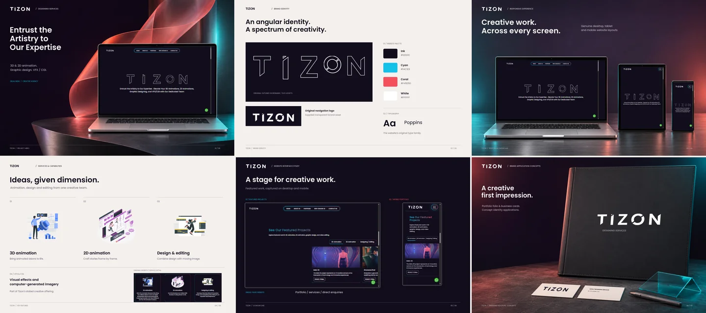

# Tizon

## Overview

Tizon is a single-page website presenting animation, graphic design, and video-editing services. Visitors can explore featured projects, open project videos, read about the team’s offering, and request a call through email or WhatsApp.

## Project Preview



## Key Features

- Six content sections with fixed navigation and desktop section snapping.
- Three featured projects selected through category links with an active underline.
- Horizontal portfolio transitions and arrow-key navigation.
- Animated industry-guidance strip with reduced-motion support.
- Responsive service cards, SVG branding, and optimized WebP images.
- Call-request dialog with email and WhatsApp links, plus footer contact and social links.

## Live Website & Related Repository

https://tiozn.vercel.app/


## Tech Stack

| Area | Technologies |
| --- | --- |
| Frontend | HTML, CSS, vanilla JavaScript |
| Styling | Bootstrap 5.3.1 CSS, custom styles, Poppins through Google Fonts |
| Media | SVG, WebP, PNG |
| Hosting | Static files, with the live website served on Vercel |

## Prerequisites

- A modern browser supporting CSS nesting, scroll snapping, and the native HTML dialog element.
- Python 3 if you choose to run the local server.

## Installation & Setup

1. Download or clone the repository.
2. Keep `index.html`, `css/`, `js/`, and `images/` together in the repository folder.
3. Open the site directly or use the local server described below.

External styling, fonts, and outbound services require an internet connection.

## Running Locally

To open the site directly, double-click `index.html` or right-click it and choose **Open with** followed by your browser.

To use a local server on Windows, open a terminal in the repository folder, alongside `index.html`, and run this single command.

```powershell
py -3 -m http.server 8080 --bind 127.0.0.1
```

Visit http://127.0.0.1:8080/ in your browser. Stop the server with Ctrl+C.

Publish the repository root as a static directory. The checked-in files are the deployable output.

## Project Structure

```text
.
├── .gitignore
├── .vscode/
│   └── settings.json
├── README.md
├── index.html
├── css/
│   ├── styles.css
│   └── responsive.min.css
├── js/
│   └── scripts.js
└── images/
    └── project-preview.webp
```

The images directory also contains the website’s logos, icons, illustrations, project thumbnails, and portraits. The responsive stylesheet contains readable source CSS despite its filename.
